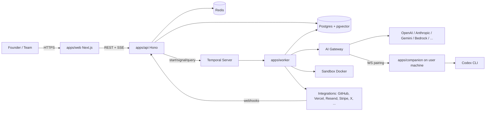

# Steward MegaPlan

Steward is a proprietary, closed-source autonomous company operating system. A founder creates or connects
a business, chooses AI providers, grants explicit permissions, and persistent agents plan and execute
business and software work under policy, budget, and approval controls, with full observability.

## 1. Executive summary

- **Control plane**: TypeScript monorepo (pnpm + Turborepo). `apps/api` (Hono), `apps/worker` (Temporal
  worker), `apps/web` (Next.js), `apps/companion` (local CLI daemon). Shared packages for schema, DB,
  AI gateway, tools, policy, memory, sandbox, integrations.
- **Durable execution**: Temporal. Every agent run, schedule, approval pause, and long-running operation
  is a workflow; nothing depends on an HTTP request staying open.
- **State**: PostgreSQL 17 + pgvector, Drizzle ORM, tenant-scoped repositories.
- **AI**: provider-neutral gateway (`@steward/ai`) with 25+ provider families, capability-aware routing,
  fallback chains, full usage/cost ledger.
- **Safety**: autonomy levels 0–4, per-dimension policies, risk classification separate from confidence,
  durable approvals, budgets, outbound safety, idempotency keys.
- **Controlled distribution**: proprietary source, Docker Compose operator boot path, documented threat model.

## 2. Product requirements

See `docs/research/PRODUCT_PARITY_MATRIX.md` for feature-level targets. Non-negotiables:
1. Company creation/ingestion with editable, versioned profile.
2. Persistent orchestrator + specialized agents with schedules.
3. Tasks with lifecycle, dependencies, ownership, results, artifacts.
4. Chat that produces durable state (tasks, decisions, memories) — not ephemeral text.
5. Live activity with drill-down to model call, tool call, cost, policy decision.
6. Approvals inbox that actually pauses/resumes workflows.
7. Provider settings supporting BYOK, cloud, local, and permitted subscription modes.
8. Engineering runs in sandboxes with PR + deploy via user-owned accounts.
9. Business integrations with real adapters or explicit "unavailable".
10. Budgets/cost ledger, audit log, RBAC, tenant isolation.

## 3. Target UX

Information architecture (per company):

```
/ (landing)                       /login /signup /verify
/onboarding/*                     idea → research → profile → providers → integrations → autonomy → plan
/app                              org/company switcher
/app/c/:companyId/overview        health, KPIs, running agents, pending approvals, spend
/app/c/:companyId/chat            conversations
/app/c/:companyId/activity        live feed + run timelines
/app/c/:companyId/tasks           board/list, task detail w/ runs, artifacts
/app/c/:companyId/agents          agent roster, schedules, config, run history
/app/c/:companyId/approvals       inbox
/app/c/:companyId/memory          knowledge, decisions, entities (search, provenance)
/app/c/:companyId/integrations    connect/manage
/app/c/:companyId/projects        repos, environments, deployments
/app/c/:companyId/inbox           support/email
/app/c/:companyId/marketing       campaigns, content calendar, social
/app/c/:companyId/sales           leads/deals
/app/c/:companyId/finance         revenue (Stripe), AI spend, budgets
/app/c/:companyId/documents       docs/artifacts
/app/c/:companyId/settings        profile, autonomy/policies, models, budgets, members, API keys, webhooks, audit
/app/org/:orgId/settings          org, members, providers, billing
```

Design system: Tailwind 4 + Radix primitives; tokens for color/spacing/radius; dark/light; dense data
tables; status chips (`queued running waiting_approval succeeded failed cancelled`); skeletons, empty states,
error states, keyboard shortcuts (`g a` activity, `g t` tasks, `⌘k` command palette), toasts, optimistic
updates where safe. Accessibility: focus rings, ARIA on live regions, reduced-motion support.

## 4. System context



## 5. Control-plane architecture

- `apps/api`: Hono + Zod OpenAPI. Middleware: request id, pino logger, CORS, secure headers, CSRF
  (double-submit + SameSite), session auth (opaque token in HttpOnly cookie, rotated on privilege change),
  API-key auth (`Authorization: Bearer sk_...` hashed lookup), rate limiting (Redis or in-memory fallback),
  tenant context (`ctx.tenant = { userId, orgId, companyId, role }`), error normalizer.
- Every repository method takes `TenantScope` as the first parameter; queries always include
  `organization_id` (and `company_id` where applicable). Lint rule + tests enforce this.
- Domain services in `packages/core`: companies, tasks, agents, approvals, memory, providers, integrations,
  budgets, events.
- Events: append-only `events` table (`type`, `company_id`, `actor`, `payload`, `correlation`). Written
  in the same transaction as the state change; `pg_notify('steward_events', id)` fans out to SSE.

## 6. Agent runtime

```
EVENT → ORCHESTRATOR → CONTEXT BUILDER → PLANNER → POLICY ENGINE → MODEL ROUTER → EXECUTOR → TOOLS → VERIFIER → PERSISTENCE → FOLLOW-UP EVENT
```

- `AgentRunWorkflow(runId)` (Temporal) drives a state machine:
  `queued → building_context → planning → executing → verifying → succeeded | failed | cancelled`, with
  `waiting_approval` and `waiting_budget` as pause states (signals resume).
- Each step is an activity with idempotency: `agent_run_steps` unique on `(run_id, step_index)`. Activities
  persist before side effects; external mutations carry `idempotency_key = hash(run_id, step_index, tool,
  args)`; tools declare `idempotent: boolean` — non-idempotent tool calls are never retried automatically
  after an ambiguous failure; the run enters `needs_review`.
- Context builder assembles: company profile, goals, relevant memories (hybrid search), task, recent runs,
  tool schemas, policy summary, budget remaining. Token-budgeted with priority ordering.
- Planner produces a typed plan (`steps[]`, `expected_outputs`, `risk_estimate`) via structured output.
- Executor loop: model call → tool calls (parallel where independent) → observations → repeat, bounded by
  `max_iterations` and budget. Tool outputs are untrusted: wrapped with provenance markers, secret-scanned,
  size-limited.
- Verifier: schema-checks results, runs tool-specific verifications (e.g., PR exists, deploy healthy,
  email accepted), and asks the model for a self-critique only as a supplementary signal.
- Results persist as `task_results`, `artifacts`, `memories`, `decisions`; follow-up events queued.

## 7. Durable workflows (Temporal)

Workflows: `AgentRunWorkflow`, `OrchestratorWorkflow` (per company, long-running, receives events and
creates tasks/runs as children), `ScheduleTick` (Temporal Schedules → orchestration events),
`ApprovalWorkflow` (timer for expiry), `IntegrationSyncWorkflow`, `DeploymentWorkflow`,
`OutboundCampaignWorkflow`, `CompanyIngestionWorkflow`.
Retry policies: transient provider errors (429/5xx/network) with exponential backoff and provider fallback;
non-retryable: policy denial, validation, non-idempotent ambiguity. Continue-as-new for orchestrator history.

## 8. AI gateway

`packages/ai`: `ProviderAdapter` interface (`chat`, `stream`, `embed`, `listModels`, `testConnection`,
`normalizeError`), `ModelCatalog` (static seed + live model lists), `Router` (`RoutingPolicy`: explicit,
task/agent override, requirements {tools, structured, vision, context ≥ N, reasoning}, cost/latency
preference, fallback chain, local-only). Every call records `ai_calls` (provider, model, tokens in/out/
cached, latency, cost estimate, status, retries, routing_reason, run/step ids). Streaming normalized to
`ChatEvent` union. Pricing from catalog (`price_per_mtok_in/out`) with `estimated: true` flag.
Adapters v1: OpenAI-compatible (covers 17 providers via config), Anthropic, Gemini, Vertex, Bedrock,
Cohere, Ollama native metadata, Codex companion. See `docs/research/AI_PROVIDER_AUTH_MATRIX.md`.

## 9. Provider authentication & local companion

Modes A–D per the auth matrix. Companion: `apps/companion` Node CLI; `steward-companion pair <code>`
exchanges a one-time pairing code for a device key; opens outbound WSS to API; accepts only
`codex.exec`, `codex.status`, `ping`; runs Codex SDK with `cwd` under `~/.steward/workspaces`; streams
events; never exposes shell. Revocable from UI. Anthropic subscription path disabled by default (ADR-0005).

## 10. Tool system & MCP

`packages/tools`: `ToolDefinition { name, description, input: ZodSchema, output: ZodSchema, scopes[],
risk, idempotent, sideEffects, timeoutMs, costCategory, handler }`. Registry composes first-party tools,
MCP servers (`@modelcontextprotocol/sdk` client, stdio + streamable HTTP), HTTP tools (declarative),
platform tools (create_task, write_memory, request_approval). Agent `tool_allowlist` intersects with
company integrations and policy. MCP tool risk defaults to HIGH unless annotated.

## 11. Memory

Layers: working (per run), conversation, company knowledge, episodic (run summaries), decisions, entities,
performance. Table `memories` with `kind, scope, content, embedding vector(1536), source, confidence,
company_id, created_by_run_id`. Hybrid retrieval: BM25 (`tsvector`) ∪ pgvector cosine, re-ranked by recency
and confidence. Writes only via `MemoryService.write(scope,…)` which validates tenant. Embedding provider
configurable; falls back to lexical search when embeddings unavailable.

## 12. Database

Postgres 17, Drizzle. Core tables: users, sessions, organizations, memberships, companies, company_profiles
(versioned), goals, agents, agent_schedules, tasks, task_dependencies, agent_runs, agent_run_steps,
ai_calls, tool_calls, approvals, policies, budgets, budget_ledger, memories, decisions, entities, artifacts,
integrations, integration_credentials, provider_credentials, api_keys, webhooks, webhook_deliveries,
events, audit_log, conversations, messages, projects, repositories, environments, deployments, leads,
deals, campaigns, contacts, suppression_list, documents. All tenant tables have `organization_id`,
company-scoped tables `company_id`, indexes on `(company_id, created_at)`.

## 13. Realtime

SSE at `/v1/companies/:id/events/stream?since=<eventId>`; server tails `events` via `pg_notify` (or Redis
pub/sub with replicas); reconnect with `Last-Event-ID` replays from DB. Web uses a single EventSource per
company feeding a normalized store.

## 14. Sandbox

`SandboxProvider` interface: `create(spec) → handle`, `exec(handle, cmd, {timeout, env})`, `putFiles`,
`getFiles`, `destroy`. `LocalDockerSandbox` (dockerode): non-root, `--cap-drop ALL`, `--read-only` +
tmpfs, mem/cpu/pids limits, network `none|egress-allowlist|full` per policy, no bind mounts of host
paths, ephemeral clones with short-lived tokens. Coding agent loop runs inside sandbox using the chosen
provider via gateway; `git`/`gh`-free push via HTTPS token to a work branch; PR via API.

## 15. Deployment & integrations

`DeploymentProvider` (Vercel, Render implemented; Railway/Fly/Cloudflare framework), `SourceControlProvider`
(GitHub implemented, GitLab framework), `DatabaseProvider` (Neon implemented, Supabase framework),
`EmailProvider` (Resend, Postmark, SendGrid, Gmail), `SocialProvider` (X), `PaymentsProvider` (Stripe),
`MessagingProvider` (Slack, Discord, Twilio). Each has contract tests against recorded fixtures and a
`testConnection`. Integration status in UI: `connected | needs_reauth | error | unavailable`.

## 16. Security, policy, autonomy

- Autonomy 0–4; per-dimension `policies` (ai_spend, infra_spend, ad_spend, email_send, social_publish,
  code_deploy, prod_deploy, db_mutation, customer_comms, payments) with `mode: deny|approve|allow`,
  `limits`. Policy engine returns `{decision, reason, requiredApproval?}` and is consulted before every
  tool call with external side effects. No global "allow everything".
- Approvals: `{action, reason, payload, risk, estimatedCost, affectedSystem, agentId, taskId, expiresAt,
  alternatives}`; approve/deny/edit-and-approve; signal to workflow.
- Budgets: monthly caps per category; reserve-then-settle ledger; soft (alert) and hard (pause) thresholds.
- Security: Argon2id passwords, session rotation, CSRF, CSP, HSTS, rate limits, SSRF guard, Zod on all
  inputs, parameterized SQL (Drizzle), envelope-encrypted secrets, audit log, signed webhooks + replay
  protection, pino redaction, prompt-injection boundary (tool outputs quoted + policy re-check), secret
  filtering of model inputs/outputs, dependency audit in CI, non-root containers.
- Threat model: `docs/THREAT_MODEL.md`.

## 17. Multitenancy

User → Organization → Membership(role) → Company. All background work carries `{orgId, companyId}` in
workflow input; activities re-validate scope. Roles: owner, admin, member, viewer. API keys org-scoped with
optional company restriction and scopes.

## 18. Observability & cost

OTel traces, pino JSON logs, `/metrics` Prometheus. Cost ledger joins `ai_calls`, `tool_calls`,
deployments, sends. Dashboards in Finance page; alerts as events + optional Slack/webhook.

## 19. Local development & production

- `docker compose up` starts postgres(pgvector), redis, temporal(auto-setup + ui), api, worker, web.
- `pnpm dev` runs apps locally against compose infra. `.env.example` documents all variables.
- Production: `docker-compose.prod.yml` with built images; external Postgres/Temporal recommended; KMS
  master key; reverse proxy TLS; isolated sandbox Docker host.

## 20. Test strategy

Vitest unit (policy, router, cost, memory ranking, schema), integration (API against Postgres via
Testcontainers-style compose, Temporal test env), contract tests for adapters (recorded fixtures +
optional live mode gated by env), Playwright E2E (onboarding, chat, approval pause/resume, provider
connect), failure injection (worker kill mid-run, provider 429/500, DB restart), security tests (tenant
isolation, CSRF, SSRF, redaction). Boot validation script `scripts/verify-boot.sh`.

## 21. Implementation phases

Aligned with the spec's phases 1–21; sequencing in this repo: docs → scaffold+infra → schema → API+auth →
AI gateway → Temporal runtime → agent runtime/tools/policy/memory → sandbox/providers → web → companion →
tests → docs. Each phase lands runnable code with tests; no phase ships mock behavior as complete.

## 22. Risks

- Provider policy changes (subscription auth) → isolated behind companion + feature flags.
- Temporal operational complexity → compose auto-setup, documented; `WorkflowEngine` abstraction thin but
  present for future adapters.
- Integration app-review requirements (Meta, Google restricted scopes) → documented; adapters real but
  gated by credentials.
- Cost blowups → hard budgets, reserve-then-settle, iteration caps.
- Prompt injection → tool-output boundaries, policy re-check, allowlists.

## 23. Acceptance criteria / definition of done

Clean clone → `.env` → `docker compose up` → onboarding → connect provider → chat → agent run visible in
activity → approval pauses/resumes → scheduled run executes → worker restart resumes run → tenant isolation
tests pass → typecheck/lint/test/build/E2E green → docs complete. Anti-fake checklist satisfied
(no mocked integrations presented as working, no in-memory durable state).

## 24. Proprietary platform & extensibility

Proprietary software; access and distribution require owner authorization. Plugin points: `ProviderAdapter`, `ToolDefinition`, `IntegrationConnector`,
`SandboxProvider`, `DeploymentProvider`, `WorkflowEngine`. Public REST API via OpenAPI + outbound webhooks.
Migration strategy: Drizzle migrations, additive changes, versioned company profiles.

ADRs: `docs/adr/`.
